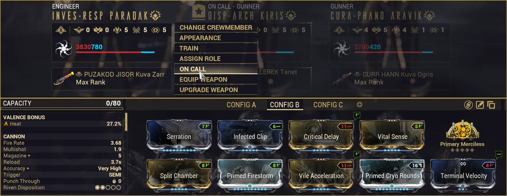

# Railjack: Optimization

Table of Contents

- [Overview](#overview)
- [Components](#components)
- [Armaments](#armaments)
- [Plexus](#plexus)
- [Crew](#crew)

## Overview

This guide touches on the major Railjack systems and provides recommendations for setting up your Railjack to easily clear regular and Steel Path missions. Do note, that due to Steel Path enemies having significantly more stats, the optimal options for many sections do vary between regular and Steel Path setups. 

---
## Components

Your Railjack has 4 main components: Shields, Engines, Plating, and Reactor. The following subsections cover the best options for each part and why.

### Shields

The recommended option is the House Lavan shields with the "+1000% energy consumed as shields" trait, which maximizes tankiness. In theory, House Zekti shields, House Zekti shields with the 25% Railjack damage trait have higher DPS but are also higher risk.

--8<-- "railjack/rj-shield-stats.html"

--8<-- "railjack/rj-shield-array.html"

### Engines

House Lavan engines have the highest speed while boosting, and House Vidar engines have the highest cruise speed. However, since boosting has no cooldown or duration, you can always be boosting when you're not shooting. Since boosting is effectively 'infinite', House Lavan engines are better due to their higher speeds.

> **Note:** Vidar engines are technically faster with the "+50% boost speed while shield depleted" perk activated, but this is very inconsistent, so I recommend choosing the Lavan engines. 

--8<-- "railjack/rj-engines-stats.html"

--8<-- "railjack/rj-engines.html"

### Plating

House Lavan plating gives the largest amount of effective health. There's no other incentive to pick anything else.

--8<-- "railjack/rj-hull.html"

### Reactor

House Zekti MK3 reactors give Strength and Range which is useful for Battle mods in both regular and Steel Path Railjack. For the traits, pick based on the hazard you find most annoying. Fire hazards are more common, but I went with electric hazards since I find them more inconvenient.

--8<-- "railjack/rj-reactor-stats.html"

> **Note:** A MK2 Zekti reactor can reach up to 80% strength which is more optimal for Seeker Volley regular Railjack missions, but it does lose out on the range and the hazard trait, which is more valuable for Steel Path Railjack.

--8<-- "railjack/rj-reactor.html"

---
## Armaments

### Regular Railjack

**Nose Turret (Pilot's gun)**

I recommend the Photor. It fires a hitscan heat-based laser with large amounts of punch through. It can bypass Corpus crewship energy shields to let you easily take out their shield generators.

**Swivel Turrets (Side guns)**

The biggest factor for turret damage is usually travel time. Plenty of weapons like the Vort and Cryophon have great damage but will miss targets due to their low projectile speeds. As such I recommend the Talyns, Apoc, Pulsars or Carcinoxx. Crew also have incredible aim so they can abuse hitscan weapons to pump out lots of damage.

Run House Lavan or Vidar armaments until you reach Gunnery Rank 9. Zekti armaments have the best damage but have significantly higher heat gain, and the Gunnery Rank 9 perk lets you rapidly cool your turrets. This ends up making Zekti the best option at that point. 

**Ordnance**

Tycho Seeker MK3. Other options are not worth considering.

### Steel Path

Steel Path enemies have significantly more defenses and health, so your optimal guns change.

**Nose Turret (Pilot's gun)**

Apocs are now an incredible option. They're hitscan and have 2 great damage types since slash and puncture function differently in Railjack. Slash status effects work similarly to viral, and puncture statuses strip armor and shields.

**Swivel Turrets (Side guns)**

With status effects mattering more now, Pulsars are my go to option since they also have puncture. They also have electricity, which causes enemies to get stuck moving in a straight line, making them easier to hit. You can also use a second set of Apocs if you so desire. Start with MK-3 Zekti versions of both and later upgrade to Zekti MK-4 versions as you earn them.

**Ordnance**

Tycho Seeker is the only good option.

---
## Plexus

### Integrated

**Auras**

You have two options: 

- **Onslaught Matrix** (damage) - Increases turret damage when Hull is 100%, reflects damage when shields are over 80%, and provides Battle mod efficiency
- **Ironclad Matrix** (defense) - Increases Hull, Armor, Shields and Shield Regen for your Railjack

**2x Speed mods**

- **Ion Burn** - Increases boost speed
- **Conic Nozzle** - Increases cruise speed

**2x Artillery mods**

Artillery is needed to take out Crew Ships easily.

- **Artillery Cheap Shot** - 60% artillery efficiency (mandatory mod IMO)
- **Forward Artillery** - Extra damage

**Other Slots**

For regular Railjack, you can fill the remaining mods with whatever you'd like. Seeker Volley will clear any threats. For Steel Path, I recommend:

- **Hyperstrike** - Turret damage
- **Predator** - Turret Critical Chance
- **Section Density** - Turret Critical Damage
- A Faction mod

### Battle

Battle mods require energy so the ideal pilots are ones that can rapidly generate energy or ignore it. These include include Lavos (no cost, just cooldowns), Protea (Dispensary + optional Bright Bonnet), and Styanax (Nourish + Rally Cry).

**Defensive**

Blackout Pulse is the best pick here. It locks down Crew Ships and lets you set up easy Forward Artillery shots. 

**Offensive**

In regular Railjack you can run whatever option you find most fun. For Steel Path I recommend Shatter Burst for its synergy with the Super option I recommend. 

**Super**

In regular Railjack, Seeker Volley is the best mod available. The homing missiles can easily clear groups of enemy ships per cast. 

However, Steel Path enemies outscale the damage Seeker Volley can put out, requiring you to cast multiple times to clear a single cluster of enemies. The new recommendation then is Void Hole. Void Hole will cluster enemies together, making them an easy target for ordnances, shatter burst rockets, and general turret fire. 

### Tactical

Tactical mods provide neat utility effects. None of these are mandatory but I recommend:

- **Form Up** - Brings everyone back to the Railjack (helpful to grab stragglers)
- **Death Blossom** - Disables turret overheating
- **Void Cloak** - Turn the Railjack invisible

---
## Crew

My recommended crew setup is:

- Engineer (left slot)
- Gunner/Pilot (middle slot)
- Gunner (right slot)

<figure class="guide-text-image__img" style="flex: 0 0 40%;">
  
</figure>

**Crew Weapons**

The best weapons for crew are AOE options. Crewmates have infinite ammo so it's best to prioritize weapons with large AOEs and limited ammo pools. Good options include the Kuva Zarr, Kuva Ogris, Sporelacer, and Tenet Arca Plasmor.

Crew and on-call crew cannot benefit from arcanes, galvanized mods, conditional mods like Argon Scope, or Rivens. That means it's best to focus on maximizing crit, elementals, AOE, and fire rate. As an example, this is my Kuva Zarr build that I run on my on-call crew.

{ .center .bordered .floored width=70% }

### Crew Stats by Role

**Engineer / On-Call**

- Pure Engineer - Repair 5 > Combat 5 > Endurance 5
- On-Call - Combat 5 > Endurance 5 > Repair 5

Best Perk Options:

- Combat - +150% Critical Chance with Rifles
- Endurance - Killing an enemy heals all nearby allies by 500 over 10 seconds

&nbsp;

**Pilot (pseudo-Gunner)** 

Crewmate piloting AI is a bit too slow to be worth using as an actual pilot. However, the elite crew trait "+25% speed for X engines" gives a global speed buff to your Railjack. This means we can use our 'pilot' crewmate as a gunner and keep the Perk benefits.

- Pilot 5 >> Gunnery 5 = Endurance 5

Best Perk Options:

- Piloting - +25% speed for Vidar/Lavan engines

&nbsp;

**Gunner**

- Gunnery 5 > Endurance 5 > Repair 5

Best Perk Options:

- Gunnery - +50% damage for Vidar/Lavan/Zetki turrets

